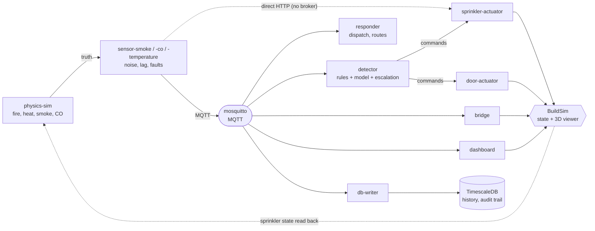

# Fire detection and autonomous emergency response

D7065E edge-intelligence project. A cyber-physical system on the course's
BuildSim: it detects a real fire (and rejects cooking and dust), puts out the
affected room's sprinkler, tells the (mock) emergency responders who is in
danger and how to get out, and keeps working when parts of it fail.

**Priorities:** safety first, then availability. A missed fire is worse than a
false alarm, and every failure degrades toward the safe action.

## Run the demo

You need Docker and a checkout of the course repo
(<https://github.com/eislab-cps/D7065E>).

```bash
cp .env.example .env          # set D7065E_DIR to your course checkout
docker compose up --build
```

- Viewer (3D building, fire-risk layer): <http://127.0.0.1:9090/?floor=level0&layer=fire-risk>
- Occupancy simulator (the people): <http://127.0.0.1:8081>

About 30 s after start a fire ignites in lecture room `level0/A1008` (10x speed).
Watch the room go **armed**, then **fire**; the sprinkler comes on, the dispatch
names who is in the room, and an evacuation route is drawn. The neighbouring
room `A1024B` stays untouched. `docker compose down -v` resets everything.

Try breaking things while it runs:

| Do this | Expect |
|---|---|
| `docker compose kill detector` | the sprinkler stays on; with no detector, the actuator's own rules take over |
| `docker compose kill mosquitto` | sprinklers still fire (direct gateway-to-actuator path); history is replayed when the broker returns |
| `curl -XPOST localhost:8091/faults/level0-A1008-smoke -d '{"mode":"stuck"}'` | the fire is still caught |
| `curl -XPOST localhost:8093/operator/level0/A1008/release` | operator releases the sprinkler (audited) |

## How it works



| Container | One job |
|---|---|
| `physics-sim` | ground truth: fire, heat, smoke and CO per room; reads sprinkler state back |
| `sensor-smoke`, `sensor-co`, `sensor-temperature` | one image (`sensor-gateway`), one process per kind (`SENSOR_TYPES`): turns truth into readings (noise, lag, stuck, offline); fault injection on :8091, :8191, :8291 |
| `mosquitto` | MQTT broker: one reading, many consumers |
| `bridge` | readings into BuildSim, with duplicate and gap accounting |
| `detector` | features, anomaly model, rule floor, heat gate, escalation, operator API |
| `sprinkler-actuator` | obeys the detector, latches, local fallback if it goes silent |
| `door-actuator` | rooms' doors are locked by default; unlocks a room in alarm; fails safe (unlocked) when the detector is silent, at start and at stop |
| `responder` | who is in danger, route out, dispatch and acknowledgement |
| `dashboard` | draws the system's state on the BuildSim viewer; component health |
| `db-writer` + `timescaledb` | history, audit trail, dead letters |
| `evac-proxy` | between occupancysim and BuildSim: walks people out of a burning room |
| `scenario-console` | pick a room, start a fire, cooking or dust; operator buttons (<http://127.0.0.1:8099>) |
| `buildsim`, `occupancysim` | course-provided: building state and the people |

The design decisions, with the alternatives that were rejected and why, are in
[`docs/L1/03-decisions.md`](docs/L1/03-decisions.md); requirements and their
tests in [`docs/L1/05-requirements-traceability.md`](docs/L1/05-requirements-traceability.md);
the physical model in [`docs/L1/04-physical-model.md`](docs/L1/04-physical-model.md);
the measured results in [`docs/results/`](docs/results/); and the report in [`report/`](report/).

## Configure a scenario

`docker-compose.yml`, service `physics-sim`:

```yaml
ROOMS: "level0/A1008:300:level0-A1008-sprinkler,..."   # level/room:volume_m3:sprinkler_id
FIRE:  "level0/A1008:medium:300"                       # level/room:slow|medium|fast:start_s
BENIGN: "cooking:level0/A1008:0:600"                   # kind:level/room:start_s:duration_s
```

Rooms named in `ROOMS` must also be listed in `ROOMS` of the three sensor services and
`sprinkler-actuator`.

## Limits worth knowing

Everything is simulated and tuned on our own simulator. People do not react to
the fire only through a simple evacuation (people walk one route to a safe room; no stairs, no crowding), the model adds little over the rules on these
scenarios, and nothing has authentication (lab only, ports bound to loopback).
See [`docs/results/`](docs/results/) and the report for the measured results and open items.

Developing or testing: see [`DEVELOP.md`](DEVELOP.md).
